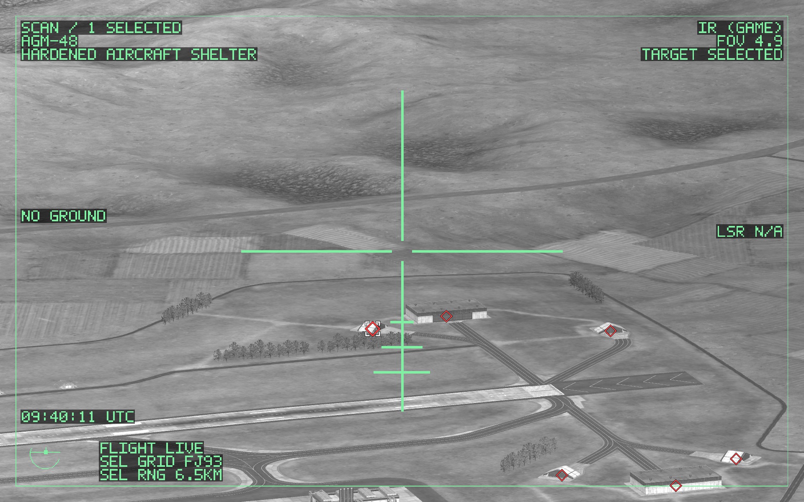
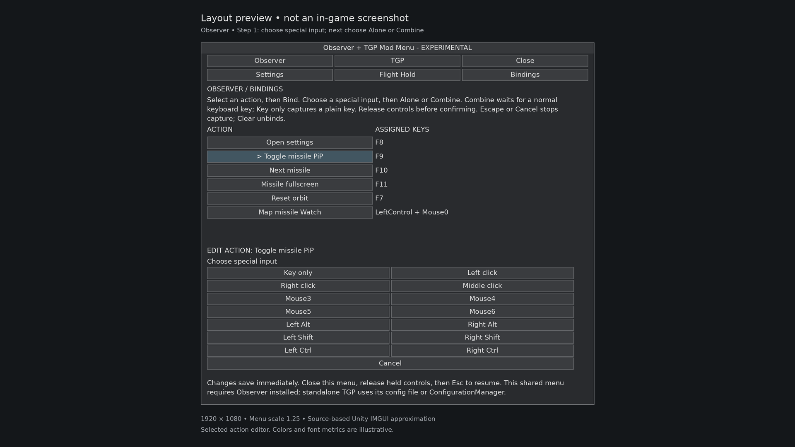
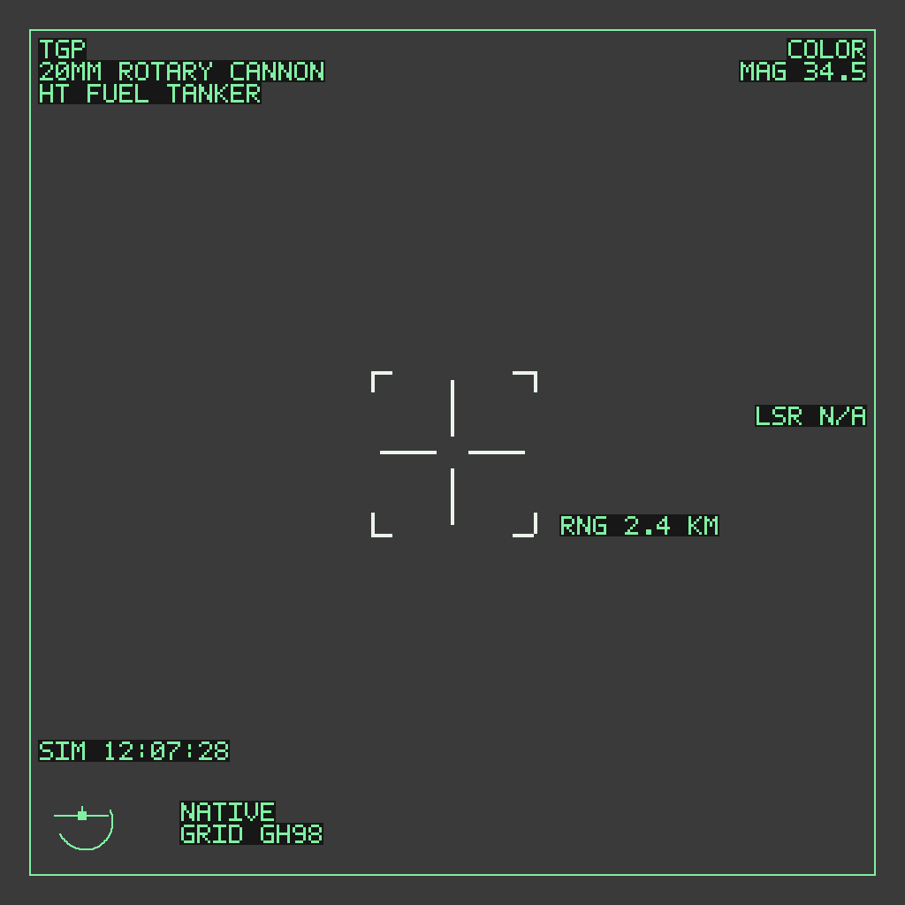
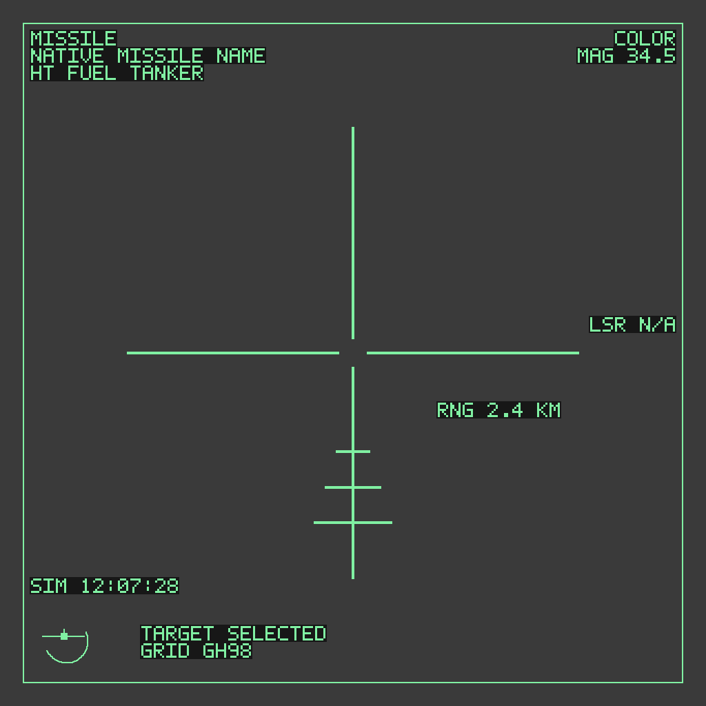

<div align="center">

# CONTROLLABLE TARGETING POD

### A closer view of Nuclear Option.

Manual sensor scanning · Native target following · Fullscreen & PiP · Game-style IR

**TGP 0.1.17** &nbsp; • &nbsp; **Nuclear Option 0.34.6** &nbsp; • &nbsp; **Windows · BepInEx 5**

### [↓ Download TargetingPodDisplay.dll](https://raw.githubusercontent.com/akwaa2545-gif/Controllable-Targeting-Pod/main/docs/downloads/TargetingPodDisplay.dll)

[Install](#installation) &nbsp; / &nbsp; [Settings tutorial](#settings-panel-tutorial) &nbsp; / &nbsp; [Controls](#controls) &nbsp; / &nbsp; [Troubleshooting](#troubleshooting)



<sub>Fullscreen Scan over an airfield: red diamonds identify known hostile contacts, white brackets show selection, and green symbology reports the sensor view.</sub>

</div>

> **TGP-only download:** one DLL for the targeting camera. Use a supported offline local cockpit. The configuration guide below covers activation, view controls, picture-in-picture and key bindings.

## What it does

| Sensor control | Viewing options | Display information |
| :--- | :--- | :--- |
| Move the pod in **Scan**, or **Follow** native selected targets | Direct **fullscreen**, optional **picture-in-picture** and cockpit display options | Green HUD symbology, known-contact markers and native selected-target information |
| Hold a valid terrain point with **AREA** ground stabilization | Switch the owned camera between **COLOR** and **IR (GAME)** | Keep camera view state within the same valid aircraft/session |

IR (GAME) uses the game's presentation, not temperature-based thermal sensing. Contact markers and selection brackets do not prove optical visibility or weapon lock. TGP by itself does not fly or stabilize the aircraft.

## Download

| File | Version | Purpose |
| :--- | :--- | :--- |
| **[TargetingPodDisplay.dll](https://raw.githubusercontent.com/akwaa2545-gif/Controllable-Targeting-Pod/main/docs/downloads/TargetingPodDisplay.dll)** | **0.1.17** | The standalone TGP mod |
| [SHA256SUMS.txt](docs/downloads/SHA256SUMS.txt) | Same DLL | Verify the download |
| [Build information](docs/downloads/BUILD_INFO.json) | Same DLL | Provenance and verification limits |

<details>
<summary><strong>Check the DLL's SHA-256</strong></summary>

Expected:

```text
5e8ca78f9a11c90539eef3193a637d4e864ca1b62f39a0012fe193be0403f7b5
```

In Windows PowerShell, from the folder containing your download:

```powershell
Get-FileHash .\TargetingPodDisplay.dll -Algorithm SHA256
```

The hash should match exactly. The filename alone does not identify a build.

</details>

## Requirements

| Component | Supported version / context |
| :--- | :--- |
| Game | **Nuclear Option 0.34.6** on Windows |
| Mod loader | Official **BepInEx 5.4.23.5 or 5.4.23.6**, including bundled **Harmony 2.9.0.0** |
| Session | **Offline, local cockpit** |
| Settings UI | Config file, or optional **ConfigurationManager** |

Exact game and loader identities are checked. Other/newer versions and modified dependency files are not automatically supported. Game and loader binaries are not supplied here. See the [official BepInEx installation guide](https://docs.bepinex.dev/articles/user_guide/installation/index.html) if you need the loader.

## Installation

1. **Close Nuclear Option.** Back up an existing TGP DLL and its configuration.
2. **Download [TargetingPodDisplay.dll](https://raw.githubusercontent.com/akwaa2545-gif/Controllable-Targeting-Pod/main/docs/downloads/TargetingPodDisplay.dll).** No ZIP extraction is needed.
3. **Copy the DLL** into your game's `BepInEx/plugins/TargetingPodDisplay/` folder. Create that subfolder if needed.
4. **Keep only one copy.** Remove older duplicate TGP DLLs from other plugin subfolders. Do not remove unrelated mods.
5. **Launch the game once.** Confirm **Targeting Pod Display 0.1.17** in `BepInEx/LogOutput.log`, then close the game before editing its config.

```text
Nuclear Option/
└── BepInEx/
    ├── plugins/
    │   └── TargetingPodDisplay/
    │       └── TargetingPodDisplay.dll
    └── config/
        └── local.nuclearoption.targetingpoddisplay.cfg
```

> [!NOTE]
> Installing the DLL is only the first step. **TGP starts disabled** and its view shortcuts start as **None**. Enable it and assign your controls below.

## First-time setup

### Standalone TGP

With the game closed, open:

```text
BepInEx/config/local.nuclearoption.targetingpoddisplay.cfg
```

1. Under `[General]`, set `Enabled = true`.
2. Under `[Keys]`, assign **Fullscreen** to an unused supported key. For example, `Fullscreen = F6` uses F6, but **F6 is only an example, not a default**. Check the game's and other mods' bindings first.
3. Assign **ScanFollow** to a different unused key if you want to keep selected targets while scanning. Optional **InfraredToggle** and **PiPToggle** also start unassigned.
4. Keep `ManualSensor = None` for the simple mouse-controlled setup. Keep `FullscreenMouseSlew = true` and `FullscreenWheelZoom = true` under `[Presentation]`.
5. Save, launch the game and enter a supported offline cockpit. Release held keys and briefly stop moving the mouse or scrolling before opening fullscreen.

Optional ConfigurationManager exposes the same settings and binding controls. Configure while paused. Preserve existing configs when updating; do not replace them with examples.

## Settings panel tutorial

### 1. Open the settings interface

**Standalone TGP:** open your installed **ConfigurationManager** with its configured shortcut, then find **Targeting Pod Display**. ConfigurationManager is an optional settings tool, not included in the DLL download. Pause before changing bindings.

**No settings tool installed?** Use the config-file steps above. Every setting in the tables below has an equivalent entry in `local.nuclearoption.targetingpoddisplay.cfg`.

**Shared-panel integration:** if an additional menu host is already installed, pause in a supported cockpit with **Esc**, open its configured Panel shortcut, then choose **TGP → Settings** or **TGP → Bindings**. The standalone DLL does **not** create the shared F8 menu shown below.



**Settings and bindings layout preview.** Select an action in the list, check its assigned input, then edit it below. This shared-panel layout is an integration preview; standalone configuration uses ConfigurationManager or the config file.

### 2. Enable the camera

Under **General**, turn **Enabled** on. Leave **ReplaceCockpit** off for a first setup, so the native cockpit display remains unchanged while you learn fullscreen/PiP.

| General setting | Default | When to change it |
| :--- | :---: | :--- |
| **Enabled** | Off | Turn on to activate TGP |
| **ReplaceCockpit** | Off | Turn on to use the owned feed on a supported cockpit target pane |

### 3. Set the viewing options

Open **Presentation** in ConfigurationManager, or the corresponding controls on the shared **Settings** page.

| Setting | Default | What it changes |
| :--- | :---: | :--- |
| **FullscreenMouseSlew** | On | Mouse-controlled scanning and no-target fullscreen entry |
| **FullscreenWheelZoom** | On | Wheel zoom for the owned fullscreen camera |
| **ScanGroundStabilization** | On | Hold valid terrain under the reticle in Scan; slew to move the held point |
| **PiPEnabled** | Off | Show a passive right-center picture-in-picture feed |
| **DisableCockpitScreen** | Off | Hide the supported cockpit target pane independently of PiP |
| **DisableCockpitScreenWhenPiPEnabled** | Off | Hide that pane only while a current PiP frame is displayed |
| **AftermathSeconds** | 3 | Show the last tracked position after a qualifying native kill notification; range 0–10 seconds, 0 disables |

**PiP layout is fixed in this build:** right-center, aspect-fitted within 28% of screen width and 40% of screen height, 16 pixels from the right edge. There are no position, size or opacity sliders. Hiding the cockpit pane changes its drawing only, not the game's targeting logic.

### 4. Bind fullscreen, scan and IR

Start with **Fullscreen**, **ScanFollow** and **InfraredToggle**. Each defaults to **None**, so assign distinct inputs you have checked against the game and other mods.

1. Select the action. In the shared layout, use **ACTION / ASSIGNED KEYS**, then **Bind**; in ConfigurationManager, use the setting's **Bind** control.
2. Choose **Key only** for a keyboard key. Release held controls, then press your chosen key.
3. For a supported mouse/Ctrl/Shift/Alt input, choose the special input, then **Alone** or **Combine**. With Alone, click **Save** and release all inputs before it commits. With Combine, release held inputs and press the ordinary keyboard key without holding the selected special input; during actual use, hold the special input with that key.
4. Check the displayed assignment and any overlap warning. A shared button may also trigger native firing, panning or selection.
5. **Clear** removes the binding. **Cancel** or **Escape** abandons capture and keeps the previous assignment.
6. Close the panel, release held inputs, then resume. Shared-panel settings save immediately, with no overall Apply button. Changes save to the config; the camera may need an explicit re-entry after a change.

Mouse0–Mouse6 support depends on what Unity receives from your hardware/OS. Wheel bindings, controller axes and Windows/Command/AltGr inputs are not added by this editor. Discrete special-input actions use a clean release gesture rather than acting on the initial press.

### 5. Add PiP controls if you want them

Enable **PiPEnabled**, then optionally bind **PiPToggle**, **PiPZoomIn** and **PiPZoomOut**. Hold a zoom key while the PiP is visible and a live feed is available. Holding both zoom keys cancels their zoom input. These shortcuts do not require ManualSensor or keyboard-sensor confirmation.

PiP is hidden during direct fullscreen. If cockpit replacement is enabled, its owned view shares the PiP camera and zoom. Neither option forces an unavailable feed to appear.

### 6. Test and save your setup

Close the panel and release all held inputs. In a supported cockpit, try your Fullscreen key, scan with the mouse, zoom with the wheel and test ScanFollow with a selected target. Try IR and PiP only after the basic view works. If an action refuses, read its exact reason in `BepInEx/LogOutput.log` before changing more settings.

**[Read the full settings walkthrough →](docs/guides/TGP_SETTINGS.md)** for keyboard scanning, config-file examples, display states and recovery steps.

## Controls

| Action | Default | Use |
| :--- | :---: | :--- |
| **Fullscreen** | `None` | Open or close the TGP fullscreen view |
| **ScanFollow** | `None` | Switch mouse Scan and native selected-target Follow |
| **InfraredToggle** | `None` | Switch COLOR / IR (GAME) on the owned sensor camera |
| **PiPToggle** | `None` | Toggle and save the optional PiP display |
| **PiPZoomIn / PiPZoomOut** | `None` | Hold to zoom a visible PiP feed outside fullscreen |
| **ManualSensor** | `None` | Optional keyboard sensor-control path |

### A first flight

1. Press your assigned **Fullscreen** key. With no selected target, use the mouse to scan and the wheel to zoom.
2. Aim near a known hostile marker and use the game's existing **Select** binding. There is no new hardcoded mouse button for target selection.
3. Selected targets use native **Follow**, including group framing. Press **ScanFollow** to search without clearing those selections, then press it again to return to Follow.
4. Use the game's existing **Cancel** binding: tap removes the newest target; hold clears all.
5. Press your **Fullscreen** shortcut again, or **Escape**, to leave the view.

Shared bindings may also trigger native game/other-mod actions. Rebind while paused. Aircraft controls and firing remain live; TGP is not autopilot.

<details>
<summary><strong>Optional keyboard sensor controls</strong></summary>

Assign **ManualSensor**, then check all eight sensor keys against the game and other mods before setting `ConfirmNoOtherModUsesSensorKeys = true`.

| Initial sensor key | Action |
| :--- | :--- |
| Arrow keys | Slew |
| PageUp / PageDown | Zoom |
| Home | Recenter |
| End | Inertial direction hold |

This extra confirmation is not required for mouse scanning, ScanFollow or optional PiP zoom. These sensor keys do not assign a Fullscreen shortcut for you.

</details>

## Reading the display

| Indicator | Meaning |
| :--- | :--- |
| **SCAN / FOLLOW** | Camera mode; Follow is not seeker lock |
| **AREA** | A valid held ground point in Scan |
| **NO GROUND** | No supported terrain was acquired |
| **MASKED** | The remembered ground point is obstructed |
| **GIMBAL LIMIT** | A manual viewing stop or unreachable held reference |
| **Red diamond / white brackets** | Known hostile / native selected target |
| **Cyan square** | Known friendly contact, display-only |

Normal manual Scan reaches up to **135° left or right of the aircraft nose**, with the rear **90° sector blocked**. Ground hold is a geometric terrain reference, not moving-object image tracking. SEL range/grid and weapon advice refer to native selected targets, not necessarily the reticle point.

## HUD gallery

<table>
<tr><th>TGP symbology</th><th>Selected-missile symbology</th></tr>
<tr>
<td></td>
<td></td>
</tr>
<tr>
<td>HUD illustration: compact targeting brackets, range, native weapon name and view information.</td>
<td>HUD illustration: selected surface-missile presentation with long split crosshair and lower reference ticks. TARGET SELECTED is selection, not seeker lock; the ticks are viewing references, not a launch-range scale.</td>
</tr>
</table>

These two images isolate the display graphics on a plain background. The full gameplay photo and settings layout preview appear above.

## Troubleshooting

<details>
<summary><strong>Nothing happens when I press a key</strong></summary>

Check `Enabled = true`, your assigned Fullscreen key, the startup version and duplicate DLLs. Fullscreen is `None` by default. Use an offline local cockpit, release held inputs and read the precise refusal in `BepInEx/LogOutput.log`.

</details>

<details>
<summary><strong>I cannot find the settings panel</strong></summary>

The TGP DLL alone does not provide the shared F8 menu. Open an installed ConfigurationManager through its configured shortcut, or edit the TGP config with the game closed. The shared-panel preview requires an additional menu host.

</details>

<details>
<summary><strong>The mouse no longer scans, or the view closes</strong></summary>

Selected targets normally engage Follow. Use ScanFollow, or clear selections with native Cancel. UI/focus loss, unsupported input mappings, conflicting ownership or game/loader identities can refuse or release the view. Stop moving/scrolling briefly before entry and check the log reason.

</details>

<details>
<summary><strong>Pink/magenta or incorrect rendering</strong></summary>

Rendering is not live-game/GPU verified. Record the aircraft, game/loader version, installed mods, exact actions and relevant log messages. No verified shader fix is promised.

</details>

<details>
<summary><strong>Updating or uninstalling</strong></summary>

Close the game first. Back up and replace the TGP DLL once; preserve its config. To uninstall, remove only `TargetingPodDisplay.dll` from plugins and keep a config backup if you may reinstall. Do not delete unrelated files or the whole BepInEx folder.

</details>

## Release notes

**Version 0.1.17 · Experimental.** Build and automated-test checks passed; live-game, hardware and GPU validation are still pending. The release targets the exact game/loader versions above. The DLL is unchanged by these documentation updates.

## Documentation & feedback

- [Complete TGP reference](docs/guides/TARGETING_POD_DISPLAY.md)
- [TGP live-game smoke checklist](docs/guides/TARGETING_POD_SMOKE_TEST.md)
- [Detailed settings-panel tutorial](docs/guides/TGP_SETTINGS.md)
- [Report an issue](https://github.com/akwaa2545-gif/Controllable-Targeting-Pod/issues)

Before posting logs publicly, check for personal paths or other private information. Include the exact version, warning and steps needed to reproduce the issue.

<details>
<summary><strong>Maintainer: GitHub Pages and website checks</strong></summary>

The static site is in `docs/`. To enable it, choose **Settings → Pages → Deploy from a branch → main → /docs → Save**. Expected URL: `https://akwaa2545-gif.github.io/Controllable-Targeting-Pod/`. Check availability after deployment before sharing it as live.

Run `python3 -m unittest discover -s tests -v` to check local links, image paths, TGP-only distribution and the DLL hash.

</details>

---

<sub>Unofficial Nuclear Option community mod. No game or loader binaries are distributed. No software license has been selected in this repository.</sub>
