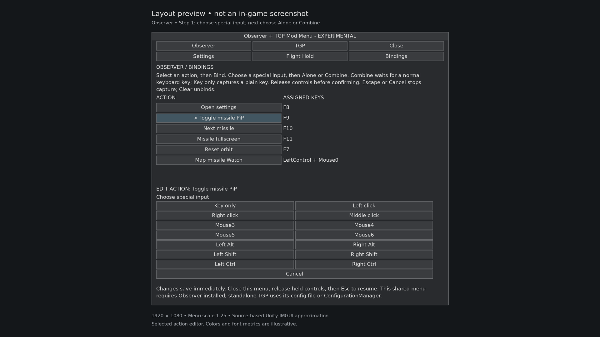
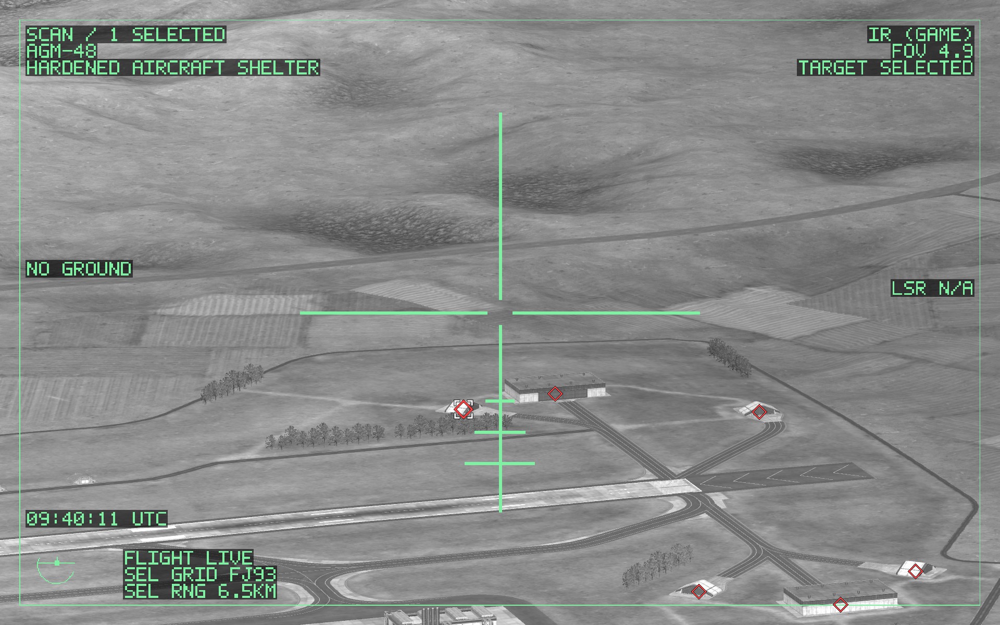
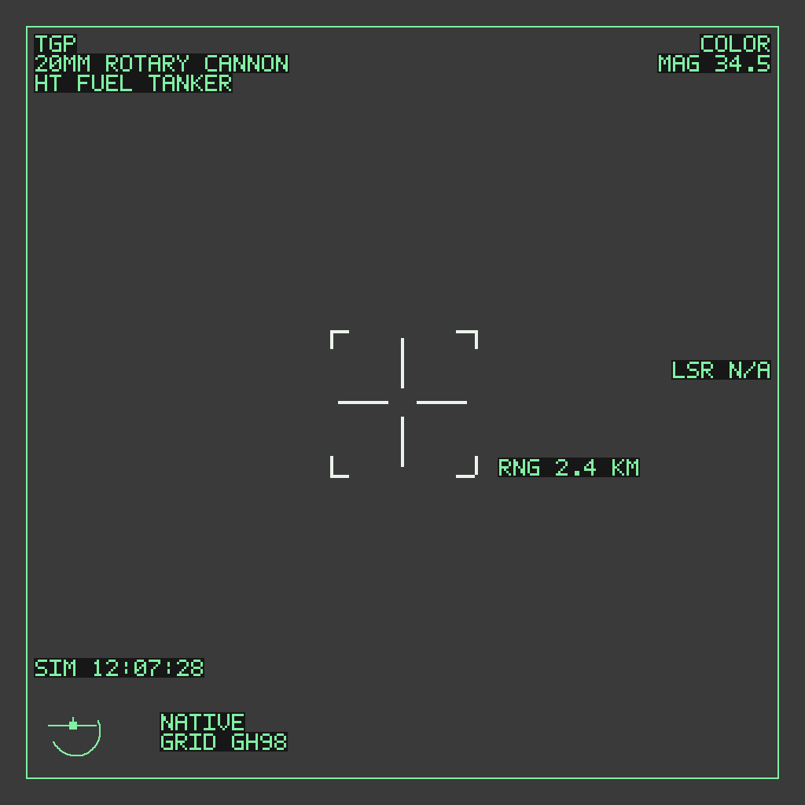
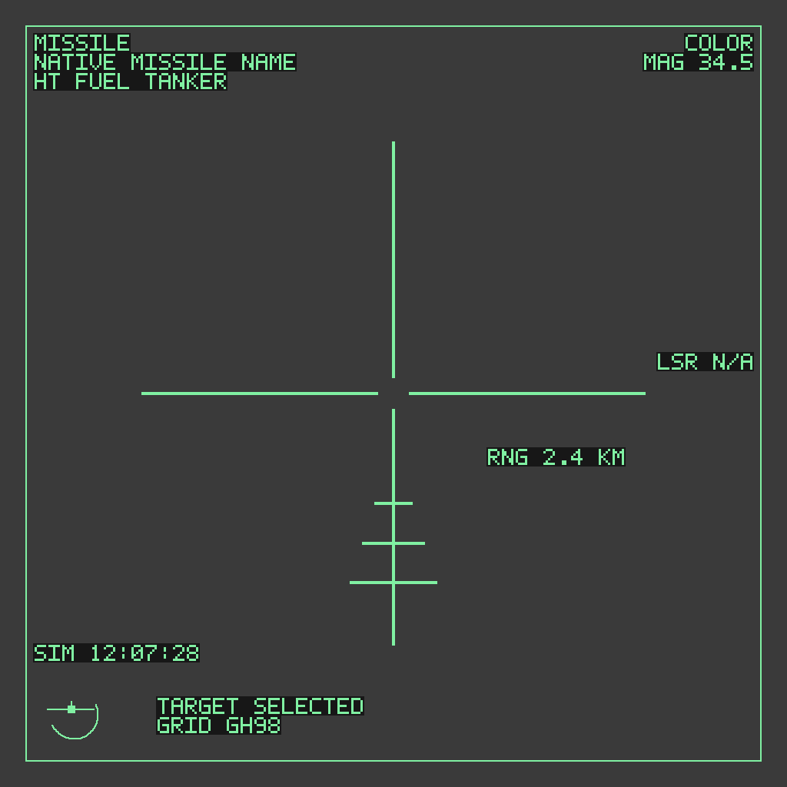

# TGP 0.1.17 settings guide

Configure fullscreen scanning, picture-in-picture, cockpit presentation and your input bindings. This guide describes the settings exposed by the shipped TargetingPodDisplay.dll.

## Choose your settings interface

- **Standalone with ConfigurationManager:** open your installed ConfigurationManager using its configured shortcut, then expand **Targeting Pod Display**. The supported custom binding interface is ConfigurationManager 19.1. That optional tool is not bundled with TGP.
- **Standalone without a settings tool:** close the game and edit `BepInEx/config/local.nuclearoption.targetingpoddisplay.cfg`. Launch once to generate it if it does not exist.
- **Existing shared-panel integration:** pause with Esc in a supported offline cockpit, open the installed host's Panel shortcut, and choose **TGP → Settings** or **TGP → Bindings**. A compatible external host is required. TGP alone does not supply the shared F8 panel.

*Interface layout preview of the shared bindings workflow. The action list, assigned input and editor are separate areas. The preview is an integration layout, not a standalone TGP menu.*

Pause while changing bindings. The settings tool does not globally suppress native controls or other mods. Preserve your current configuration when upgrading.

## First-run setup in six steps

1. Open **General** and turn **Enabled** on.
2. Assign **Fullscreen** to a supported input unused by the game and other mods.
3. For mouse scanning, keep **FullscreenMouseSlew** and **FullscreenWheelZoom** on. Leave **ManualSensor** unassigned.
4. Optionally assign **ScanFollow**, **InfraredToggle** and **PiPToggle**.
5. Enable **PiPEnabled** only if you want the small right-center view. Leave cockpit replacement/hide options off until the basic view works.
6. Close settings, release held inputs and resume. Stop mouse/wheel movement briefly before opening fullscreen. Test one change at a time.

All optional action keys begin as **None**. F6 and F5 are examples, never reserved defaults.

## General

| Setting | Default | Effect |
| --- | --- | --- |
| `Enabled` | `false` | Turns TGP on in a supported offline local cockpit. |
| `ReplaceCockpit` | `false` | Uses the owned TGP feed on a proven, uniquely identified cockpit target pane. Unsupported surfaces retain native output. |

Enabling replacement does not force an unavailable camera feed to appear. To hide the pane instead of replacing its imagery, use the presentation options below.

## Presentation

### Fullscreen mouse control

**FullscreenMouseSlew = true** enables mouse scanning and automatic no-target fullscreen entry. Move the mouse to slew while in Scan. Use ScanFollow when you want to search without clearing selected targets. Turning this off restores native mouse behavior and disables automatic no-target entry; it is not an alternate mouse-control mode.

**FullscreenWheelZoom = true** gives the owned fullscreen sensor vertical-wheel zoom. Stop scrolling before entry so the neutral-input boundary can complete. If the log reports unsupported wheel mappings, explicitly turning this off removes pod wheel zoom and leaves native scroll actions live. There is no automatic fallback that both keeps pod zoom and ignores the unsupported mapping.

### Ground stabilization

**ScanGroundStabilization = true** holds a verified terrain point as the aircraft moves. Aim at supported terrain in Scan; valid acquisition shows **AREA**. Slewing moves the held point. Turn the setting off for the legacy aircraft-relative/direction Scan behavior.

The point is geometric terrain stabilization. It does not track moving image features, steer the aircraft or create weapon lock. NO GROUND, MASKED and LIMIT explain why a point is not currently held.

### Picture-in-picture

**PiPEnabled = false** by default. Enable it for the passive right-center TGP feed. Direct fullscreen temporarily hides PiP; leaving fullscreen restores the chosen PiP setting when a valid feed is available.

Bind **PiPToggle** if you want a shortcut that changes and saves PiPEnabled. It does not close fullscreen. For separate zoom shortcuts, bind **PiPZoomIn** and **PiPZoomOut**, then hold one outside fullscreen while PiP is visible with a live feed. Holding both cancels the zoom input. These keys do not require ManualSensor or keyboard-sensor confirmation.

PiP is aspect-fitted within **28% of screen width × 40% of screen height**, vertically centered and **16 pixels from the right edge**. These are fixed implementation values: there are no TGP window-position, size, scale, opacity or drag controls in this build.

The PiP and optional replaced cockpit display share one owned feed and zoom. Their zoom does not change the native target-camera field of view.

### Cockpit display choices

| Goal | Setting |
| --- | --- |
| Keep the native cockpit pane | Leave ReplaceCockpit and both hide options off |
| Show the owned TGP imagery in a supported pane | `General.ReplaceCockpit = true` |
| Hide the supported cockpit target pane even when PiP is off | `Presentation.DisableCockpitScreen = true` |
| Hide it only while a current PiP frame is shown | `Presentation.DisableCockpitScreenWhenPiPEnabled = true` |

Both hide options default to false. The always-hide setting takes precedence over replacement. The PiP-only option restores the pane when PiP stops or direct fullscreen starts. These controls hide only the proven target-screen image; native targeting/camera logic, radar and landing displays remain active. They do not establish a measured FPS improvement.

### Aftermath view

**AftermathSeconds = 3** is the only numeric TGP panel setting. The supported range is **0–10 seconds**; set it to **0** to disable.

A qualifying native kill report for the uniquely watched target can briefly show a live view of its last known tracking position. It is not a frozen image. Ordinary deselection, despawn or cleanup does not establish a kill. New targeting/manual action or context loss ends the aftermath view.

## Binding editor, step by step

On the shared panel, the list headings are **ACTION** and **ASSIGNED KEYS**. Selecting an action opens **EDIT ACTION** below. ConfigurationManager exposes a **Bind** control for the corresponding key entry.

### Bind a normal keyboard key

1. Select the action, then **Bind**.
2. Choose **Key only**.
3. Release held keys/buttons, then press one supported ordinary keyboard key.
4. Check the saved assignment and any warning before leaving the panel.

### Bind one special input alone

1. Select **Bind**, then the required mouse button or Left/Right Ctrl, Shift or Alt.
2. Choose **Alone**.
3. Click **Save**.
4. Release all inputs. Both the Save click and the selected special input must return to neutral before the assignment commits.

Special-alone toggle actions use a clean isolated release. Special-alone held controls need a fresh isolated press. Another key/button or a context interruption cancels that gesture.

### Combine a special input with a keyboard key

1. Select **Bind**, then the mouse button or modifier.
2. Choose **Combine**.
3. Release held inputs and press the ordinary keyboard main key. **Do not hold the selected special input during capture.** The editor already knows which special input you chose.
4. During actual use, hold the chosen special input with the main key.

### Clear, cancel and conflicts

- **Clear** unbinds the action.
- **Cancel** or **Escape** abandons capture and preserves the previous assignment.
- **Back** returns to the input picker.
- **Details** shows the selected action's information.
- Recognized overlaps show warnings, not global input suppression. The game or another mod can still respond to the same input.
- Unsupported or unverifiable inputs leave the prior binding unchanged.

Shared-panel settings save immediately; there is no overall Apply button. Main key and modifier values commit together. The **Save** button above belongs specifically to the special-input Alone step.

Mouse0–Mouse6 depend on what Unity receives from the hardware/OS. Controller axes, wheel bindings, Windows/Command/AltGr, OS-only inputs and legacy shifted-character aliases are not added. Escape remains cancellation. For plus, use the physical Shift+Equals combination or KeypadPlus.

## Action reference

| Shared-panel action | Config entry | Default |
| --- | --- | --- |
| Toggle TGP fullscreen | `Keys.Fullscreen` | `None` |
| Toggle keyboard sensor control | `Keys.ManualSensor` | `None` |
| Toggle Scan / Follow | `Keys.ScanFollow` | `None` |
| Toggle TGP PiP | `Keys.PiPToggle` | `None` |
| Toggle COLOR / IR | `Keys.InfraredToggle` | `None` |
| Zoom PiP in (hold) | `Keys.PiPZoomIn` | `None` |
| Zoom PiP out (hold) | `Keys.PiPZoomOut` | `None` |

The original main-key values are stored under `[Keys]` and `[SensorKeys]`. Modifier companions live under `[KeyModifiers]`, for example `Keys.Fullscreen`. Empty modifier companions preserve plain-key behavior. Use the binding editor for combinations so both parts are saved consistently.

IR toggles the owned camera between COLOR and **IR (GAME)**. It follows the game's presentation calibration, not physical heat signatures. The mode choice is session-only for the same valid aircraft/camera context.

## Optional keyboard-manual scanning

For mouse-only scanning, leave ManualSensor unbound and keep the confirmation off.

For keyboard-manual scanning:

1. Bind **ManualSensor**.
2. Review all eight **SensorKeys** against native controls and other mods' raw-key shortcuts.
3. Rebind any overlaps you do not want.
4. Only after that review, set **ConfirmNoOtherModUsesSensorKeys = true**.
5. Close the menu, release held inputs and test in a supported offline cockpit.

| Sensor action | Config entry | Initial key |
| --- | --- | --- |
| Slew up/down/left/right | `SensorKeys.Up/Down/Left/Right` | Arrow keys |
| Sensor zoom in/out | `SensorKeys.ZoomIn/ZoomOut` | PageUp / PageDown |
| Recenter sensor | `SensorKeys.Recenter` | Home |
| Toggle inertial direction hold | `SensorKeys.InertialHold` | End |

This confirmation is not required for mouse ScanFollow or optional PiP zoom. The sensor keys do not assign Fullscreen for you.

## Using the view

*Scan view: the sensor searches independently while known-contact diamonds and native selection markers remain visible.*

- Use your assigned Fullscreen shortcut to enter/leave, or Escape to leave.
- Use the game's existing **Select** action for eligible known contacts. Selection is not seeker lock.
- **ScanFollow** preserves selected targets while freeing the camera, then returns to native target/group Follow. With no selected targets, Scan remains active.
- Use native **Cancel**: tap removes the newest target; hold clears all.
- Normal manual Scan allows ±135° from the aircraft nose and blocks the rear 90° sector. Native Follow is separate.

| Display | Meaning |
| --- | --- |
| AREA | Valid terrain point held |
| NO GROUND | Supported terrain was not acquired |
| MASKED | Remembered point obstructed |
| LIMIT | Range/viewing limit |
| GIMBAL LIMIT | Manual viewing stop or unreachable retained reference |
| Red diamond | Native known hostile contact |
| White selection brackets | Native selected target |
| Cyan square | Known friendly, display-only |

### Display illustrations

*TGP HUD illustration: crosshair, target brackets, range, weapon name and view information shown without the scene.*

*Selected surface-missile HUD illustration: long split crosshair and three lower reference ticks. TARGET SELECTED describes selection, not seeker lock. The ticks are decorative viewing references, not a launch-range scale.*

## Saving, upgrading and recovery

- Keep existing configs when upgrading; missing entries are added during loading.
- An existing raw config can receive a one-time `.pre-mouse-chords.bak` backup before binding migration.
- If you change keys/activation, release both old and new inputs before reentry. The active view may close as part of safe reconfiguration.
- To recover an unusable shortcut, close the game, back up the config and restore a known supported unused plain key under `[Keys]`; clear that entry's companion in `[KeyModifiers]` if you intend a plain key.
- If the shared panel is unavailable, the standalone config and optional ConfigurationManager remain the supported settings routes.
- Do not delete the whole BepInEx folder to reset this mod.

## Troubleshooting checklist

1. Is TGP **Enabled** and Fullscreen assigned rather than None?
2. Is there exactly one TGP DLL, with version 0.1.17 in the startup log?
3. Are the game 0.34.6 and official BepInEx 5.4.23.5/.6 files supported?
4. Are you in a supported offline local cockpit, not external/spectator/multiplayer or landing mode?
5. Have the settings panel closed and held controls returned to neutral?
6. What precise refusal or closure reason appears in `BepInEx/LogOutput.log`?

Review logs for personal paths before posting them publicly. Aircraft controls and firing remain live; TGP does not provide autopilot.

## Release status

Version 0.1.17 is an experimental build with source/build/automated-test verification. Live-game, hardware and GPU validation remain pending. This tutorial documents the implemented settings, not a claim that all runtime behavior has been proven on a live installation.
